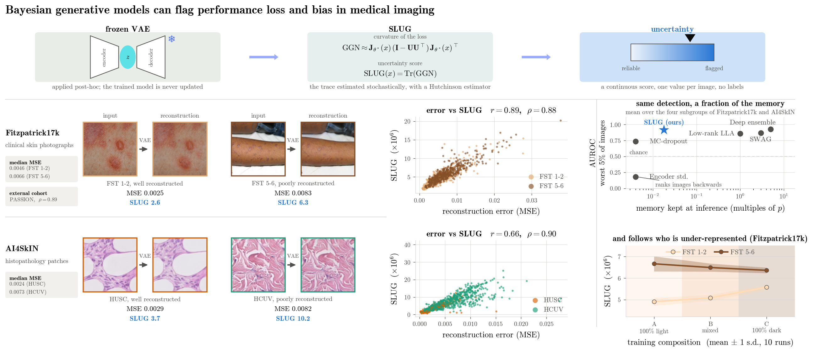

# SLUG

Epistemic uncertainty for generative models. We derive a post-hoc low-rank Laplace posterior that fits in low-memory settings.

Code for *Bayesian generative models can flag performance loss and bias in medical imaging*.



The score is

```
SLUG(x) = Tr( J(x) (I - U U^T) J(x)^T )
```

where `J` is the Jacobian of the model output with respect to its parameters and `U` holds the
top-`k` curvature directions of the Gauss-Newton matrix. In short, it measures how much the
output can still move along the directions the training data never pinned down. The trace is
estimated with a Hutchinso estimator, and `U` is found with a sketched Lanczos run, which is what keeps
it from needing the full parameter-space matrix.

This score is not computed during training, but post-hoc.

## Read this before running it

On the GPU and cuDNN we used, XLA's convolution autotuner picks a numerically broken algorithm
depending on the batch size. There is no error and no warning. 

Every entry point here therefore starts with

```python
import os
os.environ["XLA_FLAGS"] = "--xla_gpu_autotune_level=0"   # must be before `import jax`
```

## Install

```bash
conda create -n slug python=3.12 && conda activate slug
pip install -U "jax[cuda12]"        # match your driver; see the JAX install guide
pip install -r requirements.txt
```

## On your own model

The posterior is fitted once on the training set, then reused for every image you score.

```python
from uncertainty.sketched_lanczos_uncertainty import low_memory_lanczos_score_fun

fns = low_memory_lanczos_score_fun(
    model, params_dict, train_loader,
    output_shape=(128, 128, 3),
    lanczos_iterations=100,      # rank k = 90; see below
    sketch_size=10_000,
    train_batch_size=8,
)

scores = fns["approx"](images, jax.random.PRNGKey(0), 500)   # 500 Hutchinson samples
```

`params_dict` is the usual Flax `{"params": ..., "batch_stats": ...}`. The only real
requirement is that the model is differentiable in its parameters; it does not have to be a
VAE.

For the convolutional VAE use `sketched_lanczos_uncertainty.py`. It is the reference
implementation, and on that model it is fast enough.

For attention-based models we derived `sketched_lanczos_fast.py`, which compiles the model
once instead of once per image: 6.7 s against 462 s. It is equivalent.

## The configuration the paper reports

| | | |
|---|---|---|
| Image size | 128 x 128 | `configs/*.yaml` |
| Training epochs | 500 | checkpoints are named `fitz17_<latent>_<size><epochs>` |
| Training set | 1668 (Fitzpatrick17k), 2000 (AI4SkIN) | `configs/*.yaml` |
| Test set | 512 images per subgroup, fixed across compositions | `data.py` |
| Lanczos iterations | 100, giving rank `k = 90` | `--lanczos_iterations` |
| Sketch size | `s = 10^4` | `--sketch_size` |
| Stored posterior | `k*s = 9e5` floats = `0.018p` = 3.4 MiB | |
| Hutchinson samples | `S = 500` | `--hutchinson_samples` |
| Scoring batch size | 4 | see above |

Two things that are easy to get wrong:

**Rank and Lanczos iterations are different numbers.** `k = round(0.9 * lanczos_iterations)`,
so `--lanczos_iterations 100` gives you a rank-90 posterior.

**The bias sweep and the baseline tables use different result sets.** The sweep is 10
independent runs (`Results/0` ... `Results/9`) and the box plots are over those. The baseline
comparison is 5 seeds on one fixed split (`Results/0_seed0` ... `Results/0_seed4`), so every
method sees identical data and the only thing that differs is the method. 

The stored posterior lives in parameter space, so its size does not depend on the image
resolution.

## Reproducing the paper

```bash
# bias sweep: 10 runs x 3 training compositions, per dataset
python src/run_study.py --config configs/fitzpatrick17k.yaml --study-dir outputs/fitz_study

# baselines: 5 seeds on a fixed split, then the post-hoc methods on top
bash scripts/uq_baselines_performance_train.sh
bash scripts/uq_baselines_performance_posthoc_eval.sh
python src/ensemble_var.py --dataset fitz --nepoch 500 --results_dir outputs/uq_baselines_performance
python analysis/swag_experiment.py --dataset fitz --swag_n_vec 1
python analysis/low_rank_lla_memory_matched.py --dataset fitz --lanczos_iterations 2 --lanczos_eigenvectors 1

# external validation
python analysis/passion_prepare.py
python analysis/passion_slug_experiment.py --subset 0.5 --run_dir 0

# tables and figures
python analysis/table_auroc_combined.py
python analysis/figure_bias_sweep.py --dataset fitz --metric MSE --methods mse encoderstd slug --trend
python analysis/figure_correlation.py --dataset fitz --method slug
python analysis/figure_graphical_abstract.py
```

Shell scripts call `${PY:-python}`, so point them somewhere else with
`PY=/path/to/python bash scripts/...` if you need to.

### The modern architectures

The same score on a Stable Diffusion autoencoder and on a latent diffusion model we trained
on top of it. We compute the SLUG score on the decoder.  These need `diffusers` and `transformers`, and pull pretrained weights from the
Hugging Face hub the first time they run.

Fitting and scoring are split here, so one posterior can be shared across parallel scoring
jobs. The cache holds the `(s, k)` eigenvector matrix and nothing else.

```bash
# Stable Diffusion autoencoder: fit the posterior once, then score each subgroup
python analysis/ldm_experiment.py --mode fit   --cache outputs/ldm
python analysis/ldm_experiment.py --mode score --cache outputs/ldm --domain fitz_light

# latent diffusion: train on the cached latents, then score the denoiser
python analysis/ldpm_train.py --dataset fitz --subset 0.5 --run 0 --seed 0 \
    --save_dir outputs/ldpm_fitz
python analysis/ldpm_uq.py --dataset fitz --save_dir outputs/ldpm_fitz --scope latent
python analysis/ldpm_sample.py --dataset fitz --save_dir outputs/ldpm_fitz

# the decoder-only posterior, scored against the autoencoder's own reconstruction error
python analysis/ldpm_decoder_real.py --dataset fitz --save_dir outputs/ldpm_fitz

# and scored on generations instead, which is the negative result in the paper
python analysis/ldpm_generation_uq.py --dataset fitz --save_dir outputs/ldpm_fitz \
    --scope decoder_only

python analysis/table_ldpm.py
```

`ldpm_train.py` encodes the images once and caches the latents, so the first run is slower
than the rest. `--scope` matters more than it looks: a score computed in latent space predicts
latent error well and pixel error much less well, and the paper reports both.

## Data

None of the three datasets are redistributed here.

- **Fitzpatrick17k** -- https://github.com/mattgroh/fitzpatrick17k
- **PASSION** -- https://passionderm.github.io/ (used only as a held-out test set)
- **AI4SkIN** -- https://www.nature.com/articles/s41597-025-05108-3

Point `dataset_root` in the configs at your copy.

## Citation

Manuscript under revision at *Medical Image Analysis*. 

```bibtex
@article{lopezperez2026bayesian,
  title   = {Bayesian generative models can flag performance loss and bias in medical imaging},
  author  = {L\'opez-P\'erez, Miguel and Miani, Marco and Naranjo, Valery
             and Hauberg, S{\o}ren and Feragen, Aasa},
  year    = {2026}
}
```
